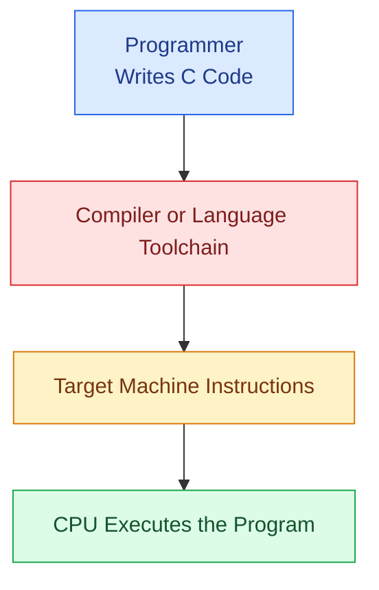
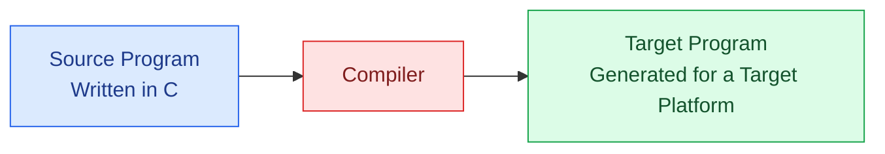
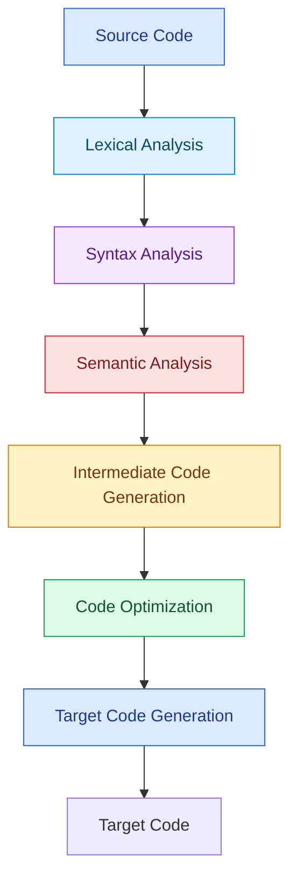
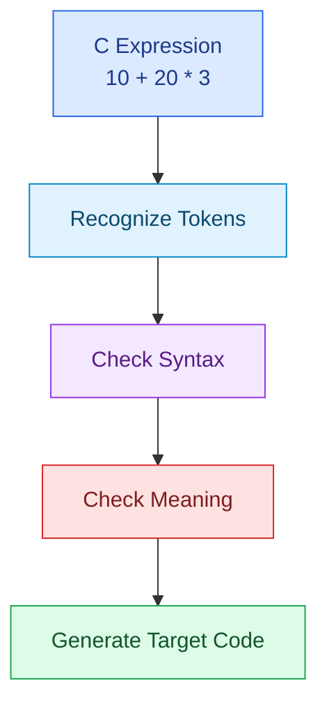
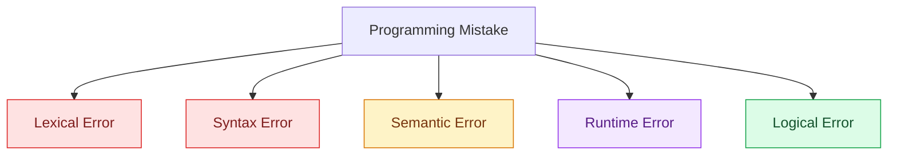

# Lesson 01: Introduction to Compiler Design

> **Course:** Compiler Design  
> **Phase:** 01 — Fundamentals  
> **Lesson:** 01  
> **Level:** Beginner

---

## Table of Contents

1. [Before We Begin](#1-before-we-begin)
2. [Why Do We Need a Compiler?](#2-why-do-we-need-a-compiler)
3. [What Is a Compiler?](#3-what-is-a-compiler)
4. [How Does a Compiler Work?](#4-how-does-a-compiler-work)
5. [A Simple Example](#5-a-simple-example)
6. [What Is Compiler Design?](#6-what-is-compiler-design)
7. [Basic Compiler Terminology](#7-basic-compiler-terminology)
8. [Types of Programming Errors](#8-types-of-programming-errors)
9. [Why Should a CSE Student Study Compiler Design?](#9-why-should-a-cse-student-study-compiler-design)
10. [Common Misconceptions](#10-common-misconceptions)
11. [Quick Revision](#11-quick-revision)
12. [Practice Questions](#12-practice-questions)
13. [Self-Assessment Checklist](#13-self-assessment-checklist)

---

## 1. Before We Begin

Think about the last time you wrote a program in C.

You might have written something as simple as:

```c id="c1a4n0"
#include <stdio.h>

int main(void)
{
    printf("Hello, World!\n");
    return 0;
}
```

You can read this code and understand what it is supposed to do. It asks the program to display a message.

But there is an interesting question:

**How does the computer understand the instructions we write in C?**

The CPU does not directly execute ordinary C statements such as `printf()` or `return 0;`. The program must be translated into a form that the target computer can execute.

That is where a compiler becomes important.

This lesson starts with that simple idea and gradually builds the foundation for the rest of Compiler Design.

---

## 2. Why Do We Need a Compiler?

### 2.1 Humans and Computers Work Differently

Humans prefer languages that are easy to read and write. Computers execute machine instructions defined by their architecture.

Consider three broad levels of programming languages.

| Language Level | Example | Main Idea |
|---|---|---|
| High-level language | C, C++, Python | Designed to be easier for humans to understand and use |
| Assembly language | `MOV`, `ADD`, `JMP` | Uses symbolic instructions associated with a processor architecture |
| Machine language | Binary instruction encodings | Instructions represented in the form required by the processor |

The exact instructions and binary encodings depend on the target architecture.

### 2.2 A Simple Illustration



This diagram shows the basic idea, not every build stage.

In a real C toolchain, preprocessing, compilation, assembly, and linking may happen before the program is ready to run.

### 2.3 A Real-Life Analogy

Imagine you are speaking Bangla to someone who understands only Japanese.

You know exactly what you want to say, but the other person needs the message in a language they can understand.

A translator helps bridge that gap.

A compiler serves a similar purpose in programming: it translates a program from a source language into a target representation while checking whether the program follows the language's rules.

The analogy is not perfect. A compiler does more than replace words: it analyzes program structure, checks meaning, and may optimize the generated code.

### 2.4 Why Not Write Everything in Machine Code?

Machine code is closely tied to the processor's instruction set. Writing large programs directly in machine code would be difficult to read, write, debug, and maintain.

High-level languages make it easier to express complex ideas. Compilers help turn those ideas into instructions suitable for a target machine.

**Key takeaway:** We write programs in languages that are convenient for humans, and compilers help translate them into forms suitable for computers.

---

## 3. What Is a Compiler?

### Definition

A **Compiler** is system software that translates a program written in a source language into an equivalent program in a target language while checking the program according to the source language's rules.

For example, a C compiler translates C source code into a target representation suitable for the selected platform.

The target may be assembly code, object code, machine code, or another representation, depending on the compiler and its configuration.

### Important Terms

- **Source language:** The language in which the original program is written.
- **Source program:** The original program supplied to the compiler.
- **Target language:** The language or representation into which the program is translated.
- **Target program:** The translated output produced by the translation process.

### Basic Diagram



### What Does "Equivalent Program" Mean?

The translated program should preserve the intended behavior of the source program for the relevant inputs, subject to the language's rules and implementation details.

For example, if a valid C program calculates the sum of two integers, the translated program should carry out the corresponding computation.

The generated instructions may look completely different from the original source code, even though they implement the same intended behavior.

---

## 4. How Does a Compiler Work?

A compiler does not simply read the entire source code and replace it with machine instructions in one mysterious step.

It usually performs several kinds of analysis and translation.

At a high level, the compiler must answer questions such as:

1. What are the individual words and symbols in the program?
2. Are those words arranged according to the language's grammar?
3. Does the program make sense according to the language's rules?
4. What lower-level representation can express the program's operations?
5. Can the generated code be improved?
6. What target instructions should be produced?

These questions lead to the major phases of a compiler.

### Overview of the Compiler Phases



This is a simplified conceptual diagram. Real compilers may combine, repeat, or organize these activities differently.

For now, do not worry about the technical details of each phase. We will study them one by one in later lessons.

### A First Look at Each Phase

| Phase | Beginner-Friendly Explanation |
|---|---|
| Lexical Analysis | Breaks the source into tokens such as keywords, identifiers, and operators |
| Syntax Analysis | Checks whether the tokens follow the language's grammar |
| Semantic Analysis | Checks meaning-related rules, such as whether an operation is valid for its operands |
| Intermediate Code Generation | Produces an intermediate representation of the program |
| Code Optimization | Attempts to improve the code without changing its required behavior |
| Target Code Generation | Produces code for the selected target architecture or representation |

**Remember:** These are phases of compiler processing. The Preprocessor, Assembler, Linker, and Loader are related to the wider language-processing workflow, but they are not all compiler phases.

---

## 5. A Simple Example

Let's use a small C expression.

```c id="a1c0d1"
int result = 10 + 20 * 3;
```

Before thinking about machine instructions, we can reason about what the program means.

### Step 1: Read the Tokens

The important tokens include:

- `int` — a keyword
- `result` — an identifier
- `=` — an assignment operator
- `10` and `20` — integer literals
- `+` and `*` — arithmetic operators
- `;` — a statement terminator in C

Lexical Analysis identifies these tokens.

### Step 2: Check the Structure

The syntax of the declaration must follow C's grammar.

For example, removing a required semicolon or placing an operator in an invalid position may produce a syntax error.

### Step 3: Understand the Meaning

The expression is a valid integer arithmetic expression.

The variable `result` is declared as an integer, and the expression's value can be assigned to it.

### Step 4: Apply Operator Precedence

Multiplication has higher precedence than addition.

Therefore:

```text id="a1c0d2"
result = 10 + (20 * 3)
       = 10 + 60
       = 70
```

### Step 5: Translate the Program

The compiler eventually generates target code that implements the declaration and calculation.

We do not need to know the exact machine instructions yet. The important point is that the compiler must preserve the program's intended computation.

### Example Summary



---

## 6. What Is Compiler Design?

**Compiler Design** is the study of how compilers are organized, how they analyze programs, how they translate source code, and how they generate correct and efficient target code.

It connects ideas from several areas of Computer Science:

- Programming Languages
- Data Structures and Algorithms
- Formal Languages and Automata
- Computer Architecture
- Software Engineering

### Why Is It Called "Design"?

Building a compiler requires many decisions.

For example:

- How should the compiler recognize identifiers and numbers?
- How should it check the grammar of an expression?
- How should it detect an invalid operation?
- What intermediate representation should it use?
- How can it generate efficient target instructions?

Compiler Design studies these questions systematically.

### What Will You Learn?

As you continue through the course, you will learn how to:

1. Recognize tokens in source code.
2. Describe the grammar of a programming language.
3. Build parsers for valid program structures.
4. Check types and other semantic rules.
5. Represent program operations in intermediate code.
6. Apply code optimization techniques.
7. Generate target code.

The goal is not merely to memorize definitions. It is to understand what happens behind the scenes when you write and compile a program.

---

## 7. Basic Compiler Terminology

| Term | Meaning |
|---|---|
| Source Code | The original program written by the programmer |
| Compiler | Software that translates source code into a target representation |
| Target Code | The translated code produced for a target language or representation |
| Token | A basic unit recognized during lexical analysis |
| Syntax | The structural rules of a programming language |
| Semantics | The meaning of a program or program construct |
| Optimization | An attempt to improve generated code while preserving required behavior |
| Machine Code | Instructions encoded for a particular processor architecture |
| Object File | A file containing compiled or assembled code and supporting information |
| Executable | A linked program that the operating system can prepare for execution |

Some of these terms will become much clearer in later lessons.

---

## 8. Types of Programming Errors

Understanding errors is important because a compiler does not catch every possible problem.

### 8.1 Lexical Error

A lexical error occurs when the source contains a sequence that cannot be recognized as a valid token according to the language's rules.

The exact examples depend on the programming language and compiler.

### 8.2 Syntax Error

A syntax error occurs when the program's structure violates the language's grammar.

Example:

```c id="a1c0d4"
int main(void)
{
    int number = 10
    return 0;
}
```

The declaration is missing a semicolon.

### 8.3 Semantic Error

A semantic error occurs when a program violates a language rule related to meaning or valid use.

For example, C does not allow a structure member to be accessed through a variable of an unrelated scalar type.

```c id="a1c0d5"
int number = 10;
/* number.name is invalid because number is not a structure */
```

Some semantic mistakes can be detected during compilation; other problems may remain undetected depending on the language and the situation.

### 8.4 Runtime Error

A runtime error occurs while a program is executing.

Examples may include invalid memory access or an operation that fails at runtime.

### 8.5 Logical Error

A logical error occurs when the program runs but produces an incorrect result.

Example:

```c id="a1c0d6"
int width = 5;
int height = 4;

int area = width + height; /* Incorrect formula for rectangle area */
```

The correct formula is multiplication, not addition.

### Error Overview



This diagram groups common error categories. It does not mean every error is detected by a compiler.

---

## 9. Why Should a CSE Student Study Compiler Design?

You might wonder why Compiler Design is important when you already know how to write programs.

The reason is simple: writing code and understanding how code is processed are related but different skills.

Compiler Design helps you understand:

- How programming languages are structured.
- How a compiler recognizes keywords, identifiers, and operators.
- How syntax and semantic rules are checked.
- How source code is transformed into lower-level representations.
- How optimization can improve generated code.
- How programming languages relate to computer architecture.

It also strengthens your understanding of formal languages, parsing, and language implementation.

You do not need to become a compiler engineer to benefit from these concepts. Studying the subject can help you understand programming languages and the tools that developers use every day.

---

## 10. Common Misconceptions

### Misconception 1: A Compiler Only Converts Code into Binary

Not always. A compiler may generate assembly code, object code, intermediate representation, or another target format.

### Misconception 2: A Compiler Can Detect Every Bug

A compiler can detect many language-rule violations, but it cannot generally determine whether a program implements the programmer's intended solution.

Logical errors can remain even when compilation succeeds.

### Misconception 3: Compiler Design Is Only About Writing a Compiler

Compiler Design also teaches language structure, parsing, formal methods, semantic rules, intermediate representations, and optimization.

### Misconception 4: Compilation and Execution Are the Same

Compilation translates the program. Execution runs the resulting program.

A typical native-code toolchain may also perform assembly and linking between these stages.

---

## 11. Quick Revision

- A compiler translates a source program into a target representation.
- High-level languages are designed to be easier for humans to use.
- Machine instructions depend on the target processor architecture.
- A compiler performs multiple kinds of analysis and translation.
- Compiler Design studies how these tasks are organized and implemented.
- Lexical, syntax, semantic, runtime, and logical errors are different categories.
- Successful compilation does not guarantee that a program produces the intended result.

### One-Line Memory Aid

**Recognize → Understand Structure → Check Meaning → Represent → Optimize → Generate**

This is a simplified way to remember the major activities of a compiler.

---

## 12. Practice Questions

Try answering these without looking at the notes.

### Short Questions

1. What is a compiler?
2. What are the source language and target language?
3. Why do programmers use high-level languages?
4. What is Compiler Design?
5. Name any three major phases of a compiler.

### Conceptual Questions

6. Why does a C program need to be translated before a CPU can execute its instructions?
7. Does successful compilation guarantee that a program is logically correct? Explain.
8. What is the difference between syntax and semantics?
9. Why is Compiler Design relevant to a Computer Science student?

### Practice with Code

10. What is the value of the following expression? Explain your answer.

```c id="a1c0d8"
int result = 10 + 20 * 3;
```

11. Identify the error in this code.

```c id="a1c0d9"
int main(void)
{
    int number = 10
    return 0;
}
```

12. Give one example each of a syntax error and a logical error.

---

## 13. Self-Assessment Checklist

Before moving to the next lesson, make sure you can:

- [ ] Explain why a compiler is needed.
- [ ] Define a compiler in your own words.
- [ ] Distinguish high-level language, assembly language, and machine language.
- [ ] Describe the major activities of a compiler.
- [ ] Explain the difference between syntax and semantics.
- [ ] Distinguish compilation from execution.
- [ ] Give examples of different programming errors.

---

## Conclusion

A compiler helps bridge the gap between the language in which programmers express their ideas and the target instructions a computer can execute.

Compiler Design takes us behind the scenes. It explains how a program is recognized, checked, represented, optimized, and translated.

Once you understand this foundation, the later topics—such as Lexical Analysis, Context-Free Grammars, Parsing, Semantic Analysis, and Code Generation—will fit together more naturally.

**Next Lesson:** Lesson 02 — Compiler vs. Interpreter vs. Assembler
