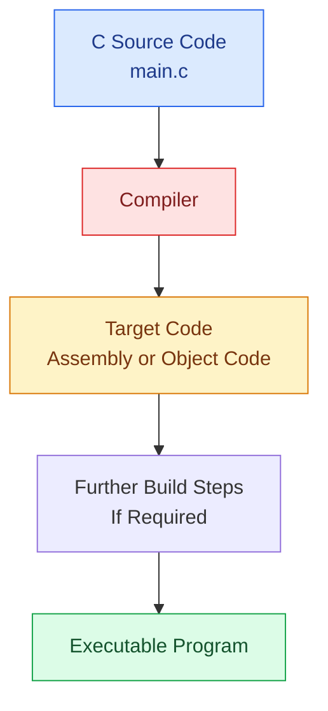
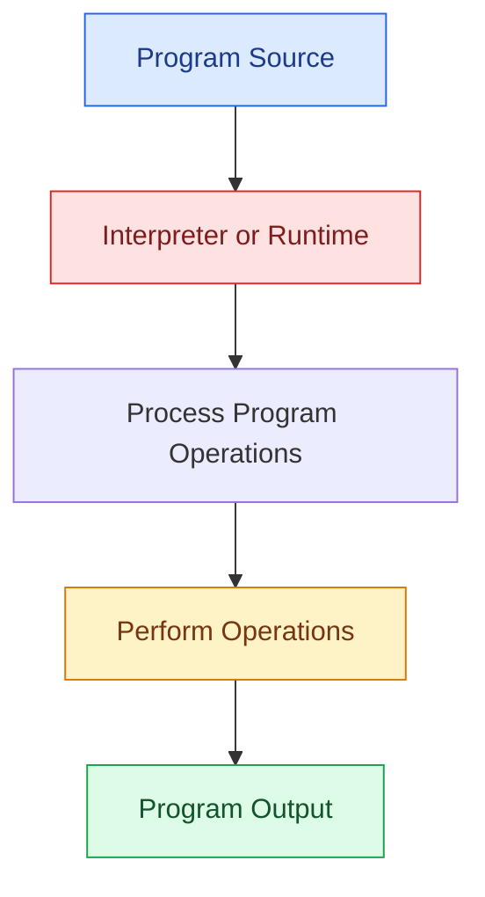
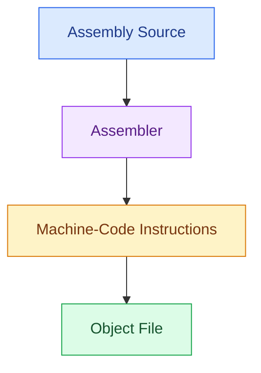
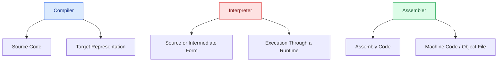
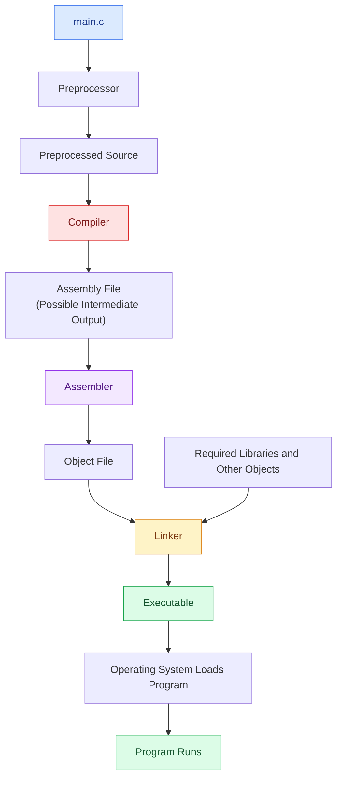
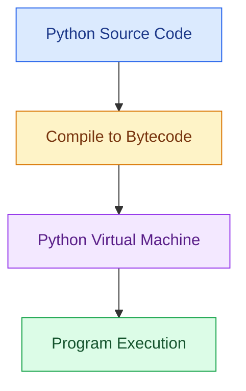

# Lesson 02: Compiler vs. Interpreter vs. Assembler

> **Course:** Compiler Design  
> **Phase:** 01 — Fundamentals  
> **Lesson:** 02  
> **Level:** Beginner

---

## Table of Contents

1. [Start with the Big Picture](#1-start-with-the-big-picture)
2. [What Is a Compiler?](#2-what-is-a-compiler)
3. [What Is an Interpreter?](#3-what-is-an-interpreter)
4. [What Is an Assembler?](#4-what-is-an-assembler)
5. [Compare the Three Tools](#5-compare-the-three-tools)
6. [A Real-Life Analogy](#6-a-real-life-analogy)
7. [How a C Program Is Built](#7-how-a-c-program-is-built)
8. [Does an Interpreter Always Run Source Code Directly?](#8-does-an-interpreter-always-run-source-code-directly)
9. [Common Misconceptions](#9-common-misconceptions)
10. [Quick Revision](#10-quick-revision)
11. [Practice Questions](#11-practice-questions)
12. [Self-Assessment Checklist](#12-self-assessment-checklist)

---

## 1. Start with the Big Picture

In the previous lesson, we learned that a compiler translates a program from a source language into a target representation.

But a compiler is not the only tool involved in programming-language translation and execution.

Three important terms often appear together:

- Compiler
- Interpreter
- Assembler

They are related, but they do not do the same job.

The easiest way to understand them is to begin with their inputs.

| Tool | Main Input |
|---|---|
| Compiler | Source code in a supported programming language |
| Interpreter | Source code or another supported representation that it processes and executes |
| Assembler | Assembly-language instructions |

The most important question is:

**What does each tool receive, and what does it do with that input?**

Keep that question in mind throughout this lesson.

---

## 2. What Is a Compiler?

### Definition

A **Compiler** is software that translates a program written in a source language into a target representation.

The target representation may be assembly code, object code, machine code, or an intermediate representation, depending on the compiler and its configuration.

### Example

Consider this C program:

```c id="b2c0a1"
#include <stdio.h>

int main(void)
{
    printf("Hello, World!\n");
    return 0;
}
```

The programmer writes the program in C.

A C compiler analyzes the source code and translates it into a target representation. In a typical native-code toolchain, the build process also involves assembling and linking before an executable is ready.

### Basic Compiler Workflow



This is a simplified workflow. The exact output and the number of separate steps depend on the toolchain.

### What Does a Compiler Do?

A compiler may perform activities such as:

1. Recognizing tokens.
2. Checking syntax.
3. Checking semantic rules.
4. Generating an intermediate representation.
5. Optimizing the program.
6. Generating target code.

We will study these activities in detail in later lessons.

### When Is a Compiler Used?

Compilers are commonly used with languages and implementations such as:

- C
- C++
- Rust
- Go

These languages and their implementations may use different compilation strategies and toolchains.

**Remember:** A compiler translates code. It does not necessarily create a standalone executable in one step.

---

## 3. What Is an Interpreter?

### Definition

An **Interpreter** is software that processes a program and performs its operations through an execution mechanism, rather than necessarily producing a separate native executable as the final result.

The exact process depends on the language and its implementation.

### A Simple Example

Consider this Python program:

```python id="b2c0a3"
name = "Junayed"
print("Hello,", name)
```

When executed using a typical Python implementation, the program prints:

```text id="b2c0a4"
Hello, Junayed
```

From the programmer's perspective, running a Python script may feel more direct than compiling a C program into a separate native executable.

However, the internal process can be more complicated.

### How Does an Interpreter Work?

A simplified conceptual model is:



This diagram describes the general idea, not every implementation detail.

### What Does an Interpreter Do?

Depending on the implementation, an interpreter may:

- Read or process source code.
- Analyze program structure.
- Execute operations using a runtime.
- Report errors encountered during processing or execution.
- Work with bytecode or another intermediate representation.

### When Is an Interpreter Used?

Interpreters or interpreter-based runtimes are used with languages and environments such as:

- Python
- Ruby
- JavaScript runtimes

The implementation details differ. Some use bytecode, some use just-in-time compilation, and some combine several techniques.

**Remember:** An interpreter is primarily associated with executing a program through an interpreter or runtime. It does not follow that every interpreter directly executes the original source text.

---

## 4. What Is an Assembler?

### Definition

An **Assembler** is system software that translates assembly-language instructions into machine code and commonly produces an object file.

Assembly language uses symbolic instructions associated with a particular processor architecture.

### Example

Consider this illustrative assembly-like instruction:

```asm id="b2c0a6"
MOV R1, #10
```

This instruction represents moving the value `10` into a register named `R1` in an assembly syntax that supports such an instruction.

**Important:** This is an illustrative example. Exact instruction names, register names, and syntax depend on the target architecture and assembler.

The Assembler translates supported assembly instructions into their machine-code encodings.

### Assembler Workflow



### What Does an Assembler Do?

An Assembler commonly:

- Translates assembly instructions into machine-code encodings.
- Resolves labels and symbols where possible.
- Produces object files.
- Records relocation and symbol information required by later build stages.

### When Is an Assembler Used?

Assemblers are used when working with:

- Low-level system programming.
- Processor-specific assembly code.
- Operating-system and embedded-system components.
- Architecture and assembly-language coursework.

**Remember:** The key distinction is the input. An Assembler processes assembly language, while a Compiler generally translates source code from a higher-level or otherwise supported language.

---

## 5. Compare the Three Tools

Now that we understand each tool individually, let's compare them directly.

| Feature | Compiler | Interpreter | Assembler |
|---|---|---|---|
| Main input | Source code | Source code or another supported representation | Assembly code |
| Main purpose | Translate a program into a target representation | Execute program operations through an interpreter or runtime | Translate assembly instructions into machine code |
| Typical result | Target code; sometimes part of a larger executable-building process | Program execution and output; may use bytecode or other intermediate forms | Object file containing machine code and supporting information |
| Separate native executable required? | Depends on the toolchain and target | Not necessarily | Usually another build stage is needed for a complete executable |
| Example | GCC or Clang used as a C compiler | CPython running Python code | NASM assembling supported x86 assembly code |

The word **typical** matters. Real programming-language implementations can combine compilation and interpretation techniques.

### Visual Comparison



### The Easiest Way to Remember

- **Compiler:** Translates source code into a target representation.
- **Interpreter:** Processes and executes a program through a runtime or interpretation mechanism.
- **Assembler:** Converts assembly instructions into machine code.

If you remember their main inputs and purposes, many exam questions become easier.

---

## 6. A Real-Life Analogy

Imagine three people doing three different jobs.

### The Compiler: A Translator Preparing a Complete Document

A translator receives a document and prepares a translated version in another language.

This resembles a compiler translating source code into a target representation.

### The Interpreter: Someone Explaining Instructions While Carrying Them Out

Imagine a person who reads a set of instructions and carries out the requested actions through an ongoing process.

This resembles the broad idea of an interpreter executing a program.

The analogy is not exact, because real interpreters and runtimes may process source code, bytecode, or other representations.

### The Assembler: Someone Following a Technical Instruction Sheet

Imagine a technical instruction sheet that uses symbolic commands for a particular machine. The assembler converts those symbolic commands into the machine's encoded instructions.

This is similar to an Assembler translating assembly-language instructions into machine code.

### What Should You Take Away?

The three tools are related to programming-language processing, but they accept different kinds of input and perform different jobs.

Do not memorize only the analogies. Always connect each tool to its actual role.

---

## 7. How a C Program Is Built

Let's connect the three tools to a real build process.

Suppose you have a file named `main.c`.

```c id="b2c0a9"
#include <stdio.h>

int main(void)
{
    printf("Hello, World!\n");
    return 0;
}
```

A typical native-code build process may look like this:



### Step 1: Preprocessing

The Preprocessor handles directives such as `#include` and `#define`.

### Step 2: Compilation

The Compiler analyzes the preprocessed source and generates target code. A separate assembly file may be produced.

### Step 3: Assembly

If the build process produces assembly code as a separate file, the Assembler translates it into an object file.

### Step 4: Linking

The Linker combines the object file with other required objects and library components, resolving external references.

### Step 5: Loading and Execution

The operating system prepares the executable for execution, and the program runs.

### Important Detail

You may run a single command such as:

```bash
gcc main.c -o program
```

This does not mean that the Compiler alone performs every task. The compiler driver can invoke the necessary tools for the build.

Also, the toolchain may skip the creation of a separate assembly file or use a different internal route.

---

## 8. Does an Interpreter Always Run Source Code Directly?

No. This is one of the most important details to understand.

A common beginner explanation says:

- A compiler translates the whole program first.
- An interpreter executes the source code directly, one line at a time.

This is a useful starting point, but it is too simple to describe every modern implementation accurately.

### Example: CPython

CPython, the standard and most widely used implementation of Python, typically compiles Python source into bytecode and executes that bytecode using its virtual machine.

A simplified view is:



This is a simplified conceptual model. Actual behavior can include caching, implementation-specific optimizations, and other runtime details.

### What Is Bytecode?

**Bytecode** is an intermediate representation designed for execution by a virtual machine or another runtime mechanism.

It is not the same thing as the native machine code executed directly by a physical CPU.

### What About JavaScript?

JavaScript engines may interpret code, compile it into machine code using just-in-time compilation, or combine multiple techniques.

This is why it is better to understand the execution model of a particular implementation instead of assuming that every interpreter works in exactly the same way.

### Exam-Friendly Answer

An interpreter executes a program through an interpretation or runtime mechanism. It does not necessarily execute the original source text directly; some implementations first compile source code into an intermediate form such as bytecode.

---

## 9. Common Misconceptions

### Misconception 1: Every Compiler Produces a Separate Assembly File

**Correction:** A compiler may produce assembly code, object code, or another target representation. Some toolchains do not generate a separate assembly file.

### Misconception 2: An Interpreter Never Compiles Anything

**Correction:** Some interpreter-based implementations compile source code into bytecode or use just-in-time compilation.

### Misconception 3: An Assembler Is the Same as a Compiler

**Correction:** An Assembler specifically translates assembly-language instructions into machine code. A Compiler generally translates a source language into another representation.

### Misconception 4: A Compiler Always Produces a Complete Executable

**Correction:** A compiler may produce only target code or an object file. Linking may still be required.

### Misconception 5: One Tool Must Perform Only One Internal Activity

**Correction:** Modern toolchains and runtimes can combine several techniques. The names describe their main roles, not necessarily every internal operation.

---

## 10. Quick Revision

### Three Definitions to Remember

**Compiler:** Software that translates source code into a target representation.

**Interpreter:** Software that processes and executes a program through an interpretation or runtime mechanism.

**Assembler:** Software that translates assembly-language instructions into machine code.

### One-Minute Revision Table

| Question | Answer |
|---|---|
| Which tool translates source code? | Compiler |
| Which tool executes a program through a runtime or interpretation mechanism? | Interpreter |
| Which tool translates assembly instructions? | Assembler |
| What is bytecode? | An intermediate representation used by a runtime or virtual machine |
| What does the Linker do? | Combines program components and resolves external references |
| Must every compiler produce a separate assembly file? | No |

### Memory Trick

**Compiler = Translate**  
**Interpreter = Execute through a runtime**  
**Assembler = Assembly to machine code**

These are simplified memory aids. Real implementations may combine compilation and interpretation techniques.

---

## 11. Practice Questions

Try answering these questions before checking your notes.

### Short Questions

1. What is the main difference between a Compiler and an Assembler?
2. Define an Interpreter.
3. What is the main purpose of an Assembler?
4. What is bytecode?
5. What is the role of a Linker in a typical C build process?

### Conceptual Questions

6. Does an Interpreter always execute source code directly without compilation? Explain with an example.
7. Why might a Compiler produce an object file instead of a complete executable?
8. Why is it inaccurate to say that every Compiler must generate a separate assembly file?
9. Explain the typical process from `main.c` to a running C program.

### True or False

10. Every Compiler must generate a separate Assembly file.
11. An Assembler translates assembly-language instructions into machine code.
12. CPython typically uses bytecode as part of its execution process.
13. Compilation and linking always refer to the same operation.

For each false statement, rewrite it correctly.

---

## 12. Self-Assessment Checklist

Before moving to the next lesson, make sure you can:

- [ ] Define a Compiler, Interpreter, and Assembler.
- [ ] Identify the main input of each tool.
- [ ] Explain their major differences without relying only on memorized wording.
- [ ] Describe the typical build process of a C program.
- [ ] Explain the basic role of the Linker and Loader.
- [ ] Understand that an interpreter-based implementation may use bytecode.
- [ ] Explain why real toolchains can combine or omit separate steps.

---

## Conclusion

Compiler, Interpreter, and Assembler are related but distinct concepts.

A Compiler translates source code into a target representation. An Interpreter processes and executes a program through an interpretation or runtime mechanism. An Assembler translates assembly-language instructions into machine code.

Understanding these differences will help you follow the next lessons, where we will study how source code is processed before the compiler's internal phases begin.

**Next Lesson:** Lesson 03 — Language Processing System
