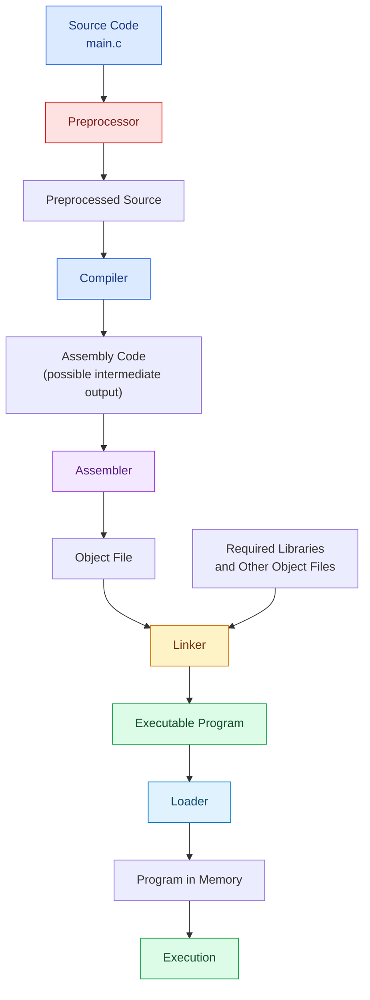
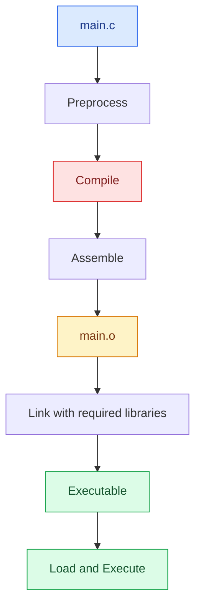
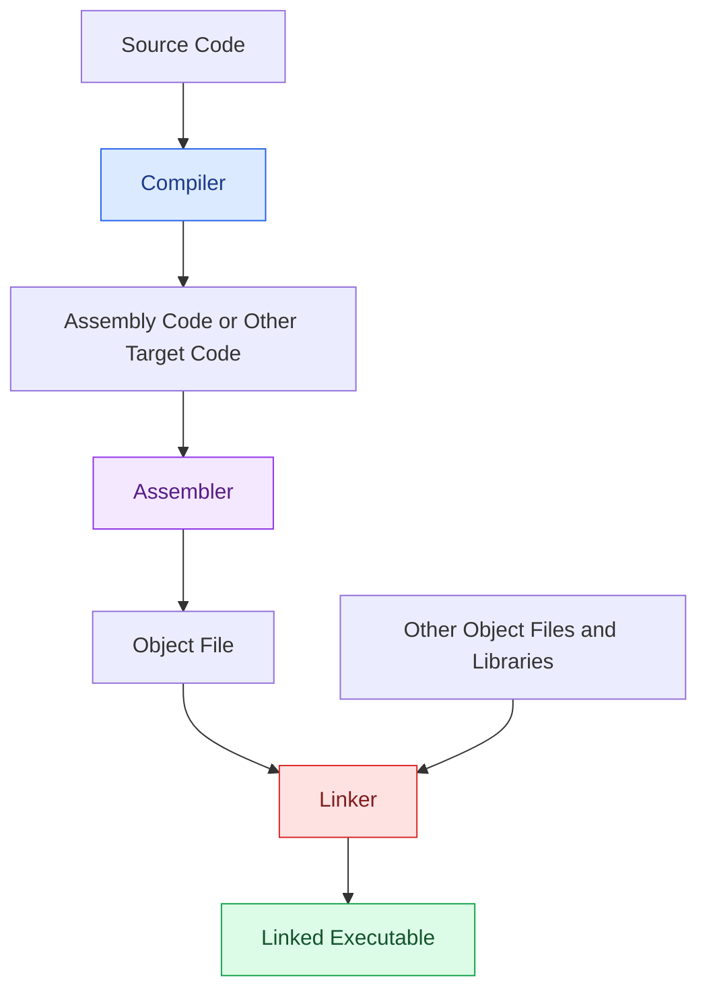
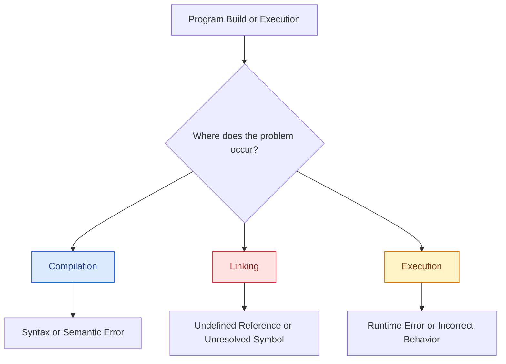

# Lesson 03: Language Processing System

> **Course:** Compiler Design
> **Phase:** 01 — Fundamentals
> **Lesson:** 03

---

## Table of Contents

1. [Learning Objectives](#1-learning-objectives)
2. [What Is a Language Processing System?](#2-what-is-a-language-processing-system)
3. [Components of the System](#3-components-of-the-language-processing-system)
4. [Complete Processing Pipeline](#4-complete-processing-pipeline)
5. [Example: Processing a C Program](#5-example-processing-a-c-program)
6. [Compiler vs. Assembler vs. Linker](#6-compiler-vs-assembler-vs-linker)
7. [Source Code vs. Object File vs. Executable](#7-source-code-vs-object-file-vs-executable)
8. [Common Errors](#8-common-errors)
9. [Common Mistakes](#9-common-mistakes)
10. [Quick Revision](#10-quick-revision)
11. [Practice Questions](#11-practice-questions)
12. [Self-Assessment Checklist](#12-self-assessment-checklist)

---

## 1. Learning Objectives

After completing this lesson, you will be able to:

- Define a Language Processing System.
- Explain the roles of the Preprocessor, Compiler, Assembler, Linker, and Loader.
- Draw the typical processing pipeline of a C program.
- Understand how source code becomes an executable program.
- Distinguish between source code, object files, and executable files.
- Identify common compilation and linking errors.

---

## 2. What Is a Language Processing System?

### Definition

A **Language Processing System** is a collection of software tools that process a source program and transform it into a form that can be executed by a computer.

In a typical C development workflow, several tools work together to prepare the program for execution.

These tools may include:

1. Preprocessor
2. Compiler
3. Assembler
4. Linker
5. Loader

**Important:** The Loader belongs to the program-loading and execution process. It is not normally considered a compiler phase.

### Real-Life Analogy

Imagine you have written a document in one language, but another person needs a final, usable version.

The document may need preparation, translation, combination with other materials, and delivery to its destination.

Similarly, a program passes through different stages before it can run.

| Programming Tool | Simple Analogy |
|---|---|
| Preprocessor | Prepares and expands the original material |
| Compiler | Translates the source program |
| Assembler | Converts assembly instructions into machine code |
| Linker | Combines required program components |
| Loader | Prepares the executable to run |

### Why Is It Needed?

A programmer usually writes code in a high-level language such as C or C++.

However, a CPU executes machine instructions, not ordinary C source code directly.

The Language Processing System helps transform the programmer's code into a form that the computer can execute.

---

## 3. Components of the Language Processing System

### 3.1 Preprocessor

The **Preprocessor** processes preprocessing directives before the main compilation stage.

Common directives include:

- `#include`
- `#define`
- `#ifdef`
- `#ifndef`

#### Example

```c
#include <stdio.h>
#define NUMBER 10

int main(void)
{
    printf("%d\n", NUMBER);
    return 0;
}
```

The Preprocessor handles the directives:

- `#include <stdio.h>` requests inclusion of the relevant header contents.
- `#define NUMBER 10` defines a macro.
- The use of `NUMBER` is replaced by `10` during macro expansion.

**Typical output:** Preprocessed source code.

> Note: The exact preprocessing behavior depends on the language and toolchain.

---

### 3.2 Compiler

A **Compiler** analyzes source code and translates it into target code.

Compiler activities may include:

- Lexical Analysis
- Syntax Analysis
- Semantic Analysis
- Intermediate Code Generation
- Code Optimization
- Target Code Generation

The exact implementation depends on the compiler.

**Possible output:**

- Assembly code
- Object code
- Intermediate representation

For example, a C compiler may translate a C source file into assembly code as an intermediate step.

---

### 3.3 Assembler

An **Assembler** translates assembly-language instructions into machine code.

It commonly produces an **Object File**.

#### Example Pipeline

```text
Assembly Code
     |
     v
  Assembler
     |
     v
  Object File
```

An object file may contain:

- Machine code
- Symbol information
- Relocation information
- Other metadata

The object file may still contain references that must be resolved by the Linker.

---

### 3.4 Linker

A **Linker** combines object files and required library components to produce a linked output, commonly an executable program.

Its responsibilities include:

- Combining object files.
- Resolving external symbols and function references.
- Processing library dependencies.
- Producing the linked output.

#### Example

Suppose a program uses a function defined in another source file.

```text
main.o + helper.o + Required Libraries
                    |
                    v
                  Linker
                    |
                    v
              Executable File
```

The Linker resolves references between these components.

If a required function implementation cannot be found, the Linker may report an **undefined reference** or **unresolved symbol** error.

---

### 3.5 Loader

A **Loader** is associated with the operating system's process of preparing a program for execution.

Its responsibilities can include:

- Loading the executable and required program segments into memory.
- Arranging the program's memory image.
- Supporting required loading and initialization operations.
- Preparing the program to begin execution.

#### Basic Flow

```text
Executable File
       |
       v
     Loader
       |
       v
  Program in Memory
       |
       v
    Execution
```

**Remember:** Creating an executable and loading it for execution are different operations.

---

## 4. Complete Processing Pipeline

This is the most important diagram in this lesson.

It shows the typical path from a C source file to a running program.



### Understand the Diagram Step by Step

| Step | Component | Main Job |
|---|---|---|
| 1 | Preprocessor | Processes directives and expands macros |
| 2 | Compiler | Analyzes and translates source code |
| 3 | Assembler | Converts assembly instructions into object code |
| 4 | Linker | Combines object files and resolves external references |
| 5 | Loader | Prepares the executable for execution |
| 6 | CPU / Execution | Executes the program's machine instructions |

### Important Note About the Pipeline

This diagram shows a **typical workflow**, not a mandatory sequence for every toolchain.

Some compilers generate object code directly without producing a separate assembly file. A compiler driver may also run several tools through one command.

For example, a single `gcc` command can invoke preprocessing, compilation, assembly, and linking as needed.

---

## 5. Example: Processing a C Program

Consider the following C program.

### Source Code

```c
#include <stdio.h>

#define NUMBER 10

int main(void)
{
    printf("Number = %d\n", NUMBER);
    return 0;
}
```

### Step 1: Preprocessing

The Preprocessor processes:

```c
#include <stdio.h>
#define NUMBER 10
```

It handles header inclusion and expands the macro.

Conceptually, the macro use becomes:

```c
printf("Number = %d\n", 10);
```

The complete preprocessed source is longer because header contents may also be included.

### Step 2: Compilation

The Compiler analyzes the preprocessed source.

It checks the program's syntax and semantics and translates the code into a target representation.

Depending on the toolchain, this may involve an assembly file.

### Step 3: Assembly

If the compiler produces assembly code as a separate intermediate output, the Assembler converts it into an object file.

Example filenames:

```text
main.s  ->  main.o
```

On some Windows toolchains, an object file may use the `.obj` extension.

### Step 4: Linking

The Linker resolves external references and combines the program with the required runtime or library components.

Conceptually:

```text
main.o + Required Libraries
              |
              v
            Linker
              |
              v
        Executable Program
```

The precise linking process depends on the operating system, compiler, and library configuration.

### Step 5: Loading and Execution

The operating system prepares the executable for execution.

The program then prints:

```text
Number = 10
```

### Example Summary Diagram



**Remember:** `Preprocess → Compile → Assemble → Link` is a common build sequence. Separate files for every stage are not always visible or generated.

---

## 6. Compiler vs. Assembler vs. Linker

These three tools have different responsibilities.



| Feature | Compiler | Assembler | Linker |
|---|---|---|---|
| Main input | High-level source or another supported source representation | Assembly language | Object files and libraries |
| Main job | Analyze and translate source code | Translate assembly instructions into machine code | Combine components and resolve external references |
| Typical output | Target code, assembly, or object code | Object file | Linked executable or another linked output |
| Common problems | Syntax and semantic errors | Invalid assembly instructions or operands | Undefined references or unresolved symbols |

**Exam Tip:** The easiest way to distinguish these tools is to remember their inputs.

- Compiler: source code
- Assembler: assembly code
- Linker: object files and libraries

---

## 7. Source Code vs. Object File vs. Executable

| File Type | Meaning | Example |
|---|---|---|
| Source Code | Human-readable program written by a programmer | `main.c` |
| Object File | Compiled or assembled output that may contain unresolved references | `main.o` or `main.obj` |
| Executable File | Linked program prepared for execution | `program.exe` or a platform-specific executable |

### Key Difference

A source file contains the program as written by the programmer.

An object file contains lower-level compiled code and supporting information. It may still need linking.

An executable is the linked program that the operating system can prepare for execution.

**Important:** File extensions vary by operating system and toolchain. Not every executable has the `.exe` extension.

---

## 8. Common Errors

Understanding which stage reports an error helps with debugging.



### 8.1 Compilation Error

Example:

```c
int main(void)
{
    int number = ;
    return 0;
}
```

The declaration is syntactically invalid, so the compiler reports an error.

### 8.2 Linking Error

Suppose a program calls a function whose implementation is missing from the linked files or libraries.

The compilation stage may succeed, but linking can fail because the required symbol cannot be resolved.

### 8.3 Runtime Error

A program may compile and link successfully but still fail during execution.

Examples include division by zero in applicable execution contexts, invalid memory access, or other runtime failures.

Not every logical mistake produces a runtime error; some programs simply produce incorrect results.

---

## 9. Common Mistakes

1. **Preprocessor and Compiler are not the same.**
   The Preprocessor handles directives and macros; the Compiler analyzes and translates source code.

2. **Object File and Executable are not necessarily the same.**
   An object file may still have unresolved external references.

3. **The Linker does not normally execute the program.**
   It produces linked output.

4. **The Loader is not a Compiler phase.**
   It is associated with preparing a program for execution.

5. **Every toolchain does not generate a separate assembly file.**
   Some compilers generate object code directly.

6. **A single command may invoke multiple tools.**
   A command such as `gcc main.c -o program` can run several build stages internally.

---

## 10. Quick Revision

| Component | Remember This |
|---|---|
| Preprocessor | Handles directives such as `#include` and `#define` |
| Compiler | Analyzes and translates source code |
| Assembler | Converts assembly instructions into object code |
| Linker | Combines object files and resolves external references |
| Loader | Prepares an executable for execution |

### One-Line Memory Trick

**Prepare → Translate → Assemble → Link → Load → Execute**

This is a simplified memory aid for a typical workflow.

---

## 11. Practice Questions

Try to answer these questions without looking at the notes.

### Short Questions

1. What is a Language Processing System?
2. What is the main role of a Preprocessor?
3. What is the difference between a Compiler and an Assembler?
4. What does a Linker do?
5. What is the role of a Loader?

### Conceptual Questions

6. Why is an object file not necessarily a complete executable?
7. What happens if an external function reference cannot be resolved during linking?
8. Can a compiler generate object code without producing a separate assembly file?
9. Why is loading a program different from compiling it?

### Diagram Practice

10. Draw the typical processing pipeline from `main.c` to program execution.
11. Draw a diagram showing how two object files and required libraries can be combined by a Linker.

---

## 12. Self-Assessment Checklist

After studying this lesson, confirm that you can:

- [ ] Define a Language Processing System.
- [ ] Explain the roles of all five components.
- [ ] Draw the typical processing pipeline.
- [ ] Explain how a C program becomes an executable.
- [ ] Distinguish source code, object files, and executable files.
- [ ] Identify common compilation, linking, and runtime errors.
- [ ] Explain why real-world toolchains may combine some stages.

---

## Conclusion

A Language Processing System uses different tools to transform source code into a program that can execute on a computer.

The Preprocessor handles preprocessing directives, the Compiler translates source code, the Assembler produces object code from assembly instructions, the Linker combines program components, and the Loader prepares the executable for execution.

Understanding this workflow provides the foundation for studying the internal phases of a Compiler.

**Next Lesson:** Lesson 04 — Phases of a Compiler
