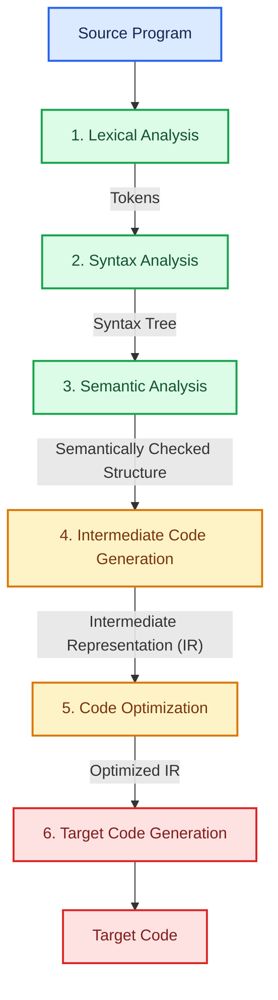
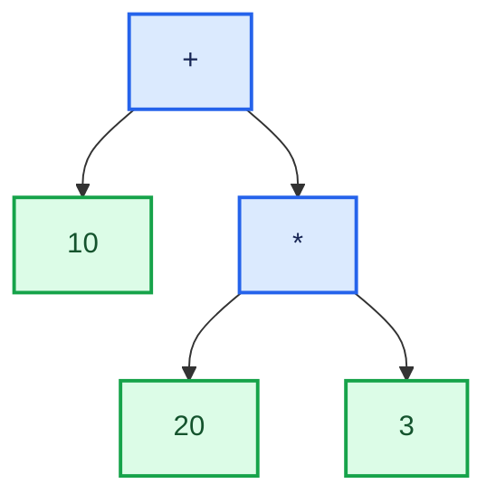
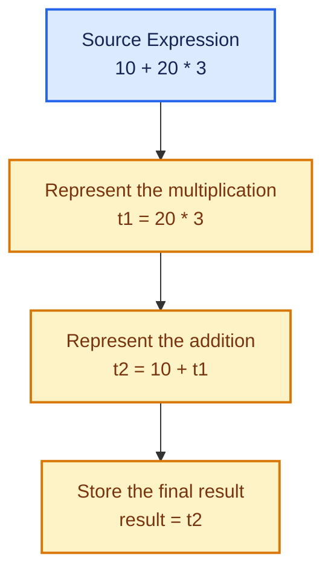
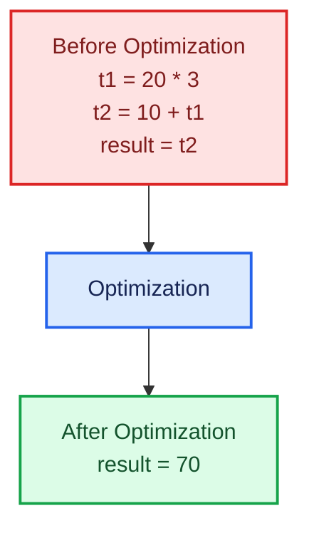
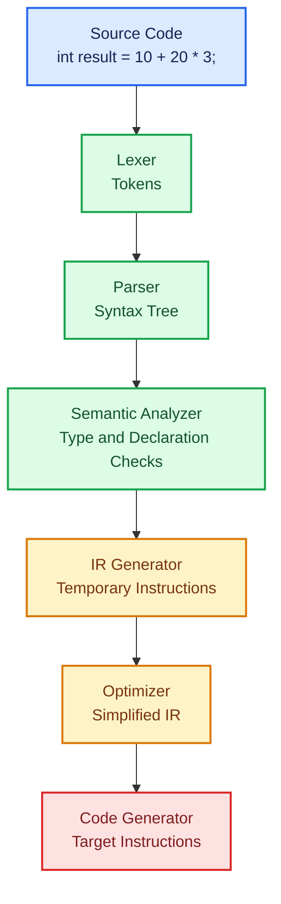
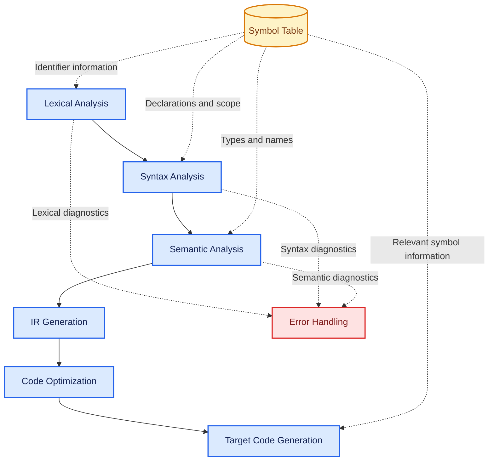
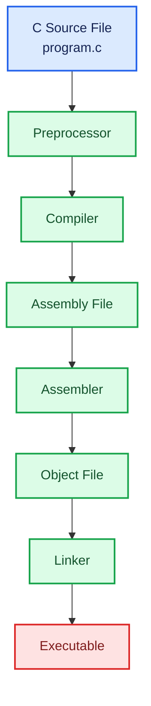

# Lesson 04: Phases of a Compiler

> **Phase 01 — Fundamentals**
>
> In this lesson, we will learn how a compiler transforms source code step by step. Instead of treating compilation as a single mysterious process, we will break it into smaller phases and understand what each phase does.

---

## Table of Contents

- [1. What Is a Compiler Phase?](#1-what-is-a-compiler-phase)
- [2. Overview of the Compiler Phases](#2-overview-of-the-compiler-phases)
- [3. Lexical Analysis](#3-lexical-analysis)
- [4. Syntax Analysis](#4-syntax-analysis)
- [5. Semantic Analysis](#5-semantic-analysis)
- [6. Intermediate Code Generation](#6-intermediate-code-generation)
- [7. Code Optimization](#7-code-optimization)
- [8. Target Code Generation](#8-target-code-generation)
- [9. Following One Statement Through Every Phase](#9-following-one-statement-through-every-phase)
- [10. Symbol Table and Error Handling](#10-symbol-table-and-error-handling)
- [11. Compiler Phases vs. Other Translation Stages](#11-compiler-phases-vs-other-translation-stages)
- [12. Common Mistakes](#12-common-mistakes)
- [13. Quick Revision](#13-quick-revision)
- [14. Practice Questions](#14-practice-questions)
- [15. Self-Check](#15-self-check)

---

## 1. What Is a Compiler Phase?

In the previous lessons, we learned that a compiler translates a program written in a high-level programming language into a lower-level target representation.

But how does it perform this translation?

Does it read the entire program once and immediately produce machine code?

Not usually. A compiler breaks this complicated task into several smaller stages. Each stage performs a particular job and passes its result to the next stage.

Each of these stages is called a **phase of a compiler**.

### A simple analogy

Imagine preparing a meal:

1. You collect the ingredients.
2. You check whether you have the correct ingredients.
3. You prepare them.
4. You cook the food.
5. You check the final result.

You would not normally perform all these activities randomly. Each step has a purpose and depends on earlier steps.

A compiler follows a similar idea. It examines the source code, checks its structure and meaning, prepares an intermediate representation, improves it when possible, and finally generates target code.

The analogy is not exact, but it helps us understand why compilation is divided into phases.

### Exam-ready definition

**A compiler phase is a logical stage of compilation that performs a specific task and transforms the program from one representation into another.**

---

## 2. Overview of the Compiler Phases

A typical compiler is described using six major phases:

1. Lexical Analysis
2. Syntax Analysis
3. Semantic Analysis
4. Intermediate Code Generation
5. Code Optimization
6. Target Code Generation

Here is the overall process.



**How to read the diagram:** Each phase receives information from an earlier stage, performs its own task, and produces a result that helps the next stage continue.

The exact internal representation can vary between compiler implementations. For learning purposes, the diagram shows the usual conceptual flow.

### A quick preview of each phase

| Phase | Main responsibility | Typical output |
|---|---|---|
| Lexical Analysis | Groups characters into meaningful units | Tokens |
| Syntax Analysis | Checks grammatical structure | Parse tree or syntax tree |
| Semantic Analysis | Checks meaning and language rules | Semantically checked structure |
| Intermediate Code Generation | Produces an intermediate representation | IR |
| Code Optimization | Improves the representation when possible | Optimized IR |
| Target Code Generation | Produces code for a target machine or platform | Target code |

Now let's understand each phase individually.

---

## 3. Lexical Analysis

Lexical Analysis is the first major phase of a compiler. It is also called **scanning**, and the component performing this work is called a **Lexical Analyzer** or **Lexer**.

A lexer reads the source code as a sequence of characters and groups those characters into meaningful units called **tokens**.

### Example

Consider this statement:

```c
int result = 10 + 20 * 3;
```

A lexer identifies units such as:

```text
int | result | = | 10 | + | 20 | * | 3 | ;
```

These units are tokens. Their categories include keywords, identifiers, operators, numeric literals, and punctuation.

| Lexeme | Token category |
|---|---|
| `int` | Keyword |
| `result` | Identifier |
| `=` | Assignment operator |
| `10` | Numeric literal |
| `+` | Arithmetic operator |
| `20` | Numeric literal |
| `*` | Arithmetic operator |
| `3` | Numeric literal |
| `;` | Punctuation |

A **lexeme** is the actual sequence of characters found in the source code. A **token** represents the category or type assigned to that sequence.

For example, `result` is a lexeme classified as an identifier.

### What does the Lexer do?

- Reads source characters.
- Recognizes valid tokens.
- Usually ignores irrelevant whitespace and comments.
- Reports lexical errors, such as an unrecognized character.
- May interact with the symbol table when processing identifiers.

### What does it not do?

The lexer does not normally determine the complete grammatical structure of an expression. That is the parser's responsibility.

### Remember

**Characters → Tokens**

Think of the lexer as the phase that breaks a long sentence into recognizable pieces before checking how those pieces fit together.

---

## 4. Syntax Analysis

Syntax Analysis is the second major phase. It is also called **parsing**.

The parser receives tokens from the lexer and checks whether they follow the grammar rules of the programming language. It also builds a structural representation of the program, commonly a parse tree or an abstract syntax tree (AST).

### Why is this phase necessary?

Consider these two statements:

```c
int result = 10 + 20;
```

```c
int result = + * 20;
```

The first statement has a recognizable structure. The second has an invalid arrangement of operators for this expression.

The lexer may recognize `int`, `result`, `=`, `+`, `*`, and `20` as individual tokens. However, recognizing individual tokens does not guarantee that they form a valid statement.

The parser checks their arrangement against the grammar.

### Understanding an expression tree

Consider:

```c
10 + 20 * 3
```

Multiplication has higher precedence than addition. Therefore, the expression is interpreted as:

```c
10 + (20 * 3)
```

A simplified syntax tree looks like this:



Read the tree from the top downward:

1. The root operator is `+`.
2. Its left operand is `10`.
3. Its right operand is the multiplication expression `20 * 3`.
4. The multiplication is grouped together before the addition.

This tree captures the expression's structure more clearly than the original character sequence.

### Parse Tree vs. Abstract Syntax Tree

These terms are related, but they are not identical.

- A **parse tree** represents the grammatical structure in more detail.
- An **Abstract Syntax Tree (AST)** keeps the essential program structure while omitting many grammar-specific details.

Both are useful representations in syntax analysis and later compiler phases.

### What does the Parser do?

- Receives tokens from the lexer.
- Checks their arrangement against grammar rules.
- Builds a parse tree or AST.
- Reports syntax errors when the structure is invalid.

### Remember

**Tokens → Syntax Structure**

The lexer recognizes the pieces; the parser checks how those pieces fit together.

---

## 5. Semantic Analysis

A program can follow the grammar rules of a language and still be invalid.

This is why a compiler needs Semantic Analysis.

Semantic Analysis checks whether the program makes sense according to the language's rules. It commonly checks declarations, types, scope, and the valid use of identifiers.

### Example 1: An undeclared variable

```c
int result = total + 5;
```

Suppose `total` has not been declared anywhere that is visible at this point.

The statement may have a valid grammatical structure, but the compiler cannot resolve the identifier `total` according to the language's declaration and scope rules.

Semantic analysis can report this problem.

### Example 2: Incompatible types

```c
int age = "twenty";
```

In C, a string literal such as `"twenty"` is not a valid value to assign directly to an `int` object. The compiler diagnoses the incompatible types.

The important point is that the problem is not simply the arrangement of tokens. It concerns whether the expression and assignment satisfy the language's type rules.

### What does Semantic Analysis check?

- Whether identifiers are declared and can be resolved.
- Whether variables are used within valid scopes.
- Whether operations use compatible types.
- Whether assignments and function calls satisfy applicable language rules.
- Whether other semantic constraints are satisfied.

The exact checks depend on the programming language.

### How is it different from Syntax Analysis?

| Syntax Analysis | Semantic Analysis |
|---|---|
| Checks grammatical structure | Checks meaning and semantic rules |
| Works with tokens and grammatical relationships | Uses structural information, declarations, types, and scope |
| Example: invalid operator arrangement | Example: assigning a string literal to an integer |

### Remember

**Syntax asks: “Is the structure valid?”**

**Semantics asks: “Does the program satisfy the language's meaning-related rules?”**

---

## 6. Intermediate Code Generation

After syntax and semantic checks, a compiler may transform the program into an **Intermediate Representation (IR)**.

IR is a representation used internally by a compiler between the source language and the target code.

Why introduce another representation instead of generating machine code immediately?

Because an intermediate representation can make optimization and target-code generation easier. It can also help a compiler support multiple source languages or target architectures, depending on its design.

### Example

Consider:

```c
int result = 10 + 20 * 3;
```

A compiler could represent the calculation using a simple form of **Three-Address Code (TAC)**:

```text
t1 = 20 * 3
t2 = 10 + t1
result = t2
```

Here:

- `t1` and `t2` are temporary names.
- Each instruction performs a relatively simple operation.
- The order of operations is explicit.

The intermediate code makes the expression's evaluation easier to follow.

### Visualizing the transformation



This is an illustrative IR, not a claim that every compiler must generate these exact instructions.

### Important points

- IR is not necessarily the final machine code.
- IR can take different forms, including three-address code, syntax trees, and compiler-specific representations.
- Later phases can optimize IR before generating target code.

### Remember

**Semantically checked structure → Intermediate Representation**

IR acts as a bridge between understanding the source program and producing target-specific instructions.

---

## 7. Code Optimization

Code Optimization attempts to improve a program's intermediate representation while preserving its required behavior.

Depending on the optimization, the compiler may reduce unnecessary calculations, remove unreachable or unused operations, or improve how values are computed.

The goal is not simply to make the code shorter. Useful optimizations may improve execution speed, reduce code size, or lower resource usage.

### Example: Constant folding

Consider:

```c
int result = 10 + 20 * 3;
```

The compiler can evaluate the constant expression:

```text
20 * 3 = 60
10 + 60 = 70
```

If the expression is eligible for constant folding, the intermediate representation could become:

```text
result = 70
```

The compiler has replaced a calculation involving constants with its result.

### Before and after



### Is optimization mandatory?

A compiler does not need to perform every possible optimization. The optimizations it applies depend on the compiler, target, optimization settings, and program.

Also, optimization must preserve the language-required behavior. A compiler cannot simply change the program's result to make it faster.

### Other examples of optimization

- **Constant propagation:** Replaces a variable's use with a known constant when safe.
- **Dead code elimination:** Removes code that cannot affect the required program behavior.
- **Common subexpression elimination:** Avoids repeating an equivalent calculation when doing so is safe.

We will study these techniques in detail in the Optimization phase of our roadmap.

### Remember

**IR → Improved IR**

Optimization tries to produce better code without changing the program's required behavior.

---

## 8. Target Code Generation

Target Code Generation is the phase that translates the compiler's internal representation into code for the intended target.

Depending on the compiler, the output may be assembly language, machine code, or another target-specific representation.

The generated instructions depend on the target architecture and its instruction set.

### Example

Suppose the optimized intermediate representation contains:

```text
result = 70
```

A simplified illustration of target assembly might look like this:

```asm
MOV R1, #70
STORE result, R1
```

**Important:** This is illustrative pseudocode, not a guarantee of valid syntax for a particular processor. Actual instructions vary by architecture and assembler.

The compiler must handle details such as instruction selection, registers, and the representation of values in the target environment.

### What does Target Code Generation do?

- Translates IR into target-specific instructions.
- Selects suitable machine instructions.
- Manages registers and storage requirements as needed.
- Produces the chosen target representation.

### Remember

**Optimized IR → Target Code**

This phase turns the compiler's internal representation into instructions suited to the intended target.

---

## 9. Following One Statement Through Every Phase

Now let's connect everything using a single statement.

```c
int result = 10 + 20 * 3;
```

Instead of memorizing six definitions separately, follow how the same statement changes through the compilation process.

### Step 1: Source code

```c
int result = 10 + 20 * 3;
```

This is the statement written by the programmer.

### Step 2: Lexical Analysis

The lexer recognizes tokens:

```text
int | result | = | 10 | + | 20 | * | 3 | ;
```

The characters have been grouped into meaningful units.

### Step 3: Syntax Analysis

The parser recognizes the grammatical structure and the operator precedence:

```text
        +
       / \
     10   *
         / \
        20  3
```

The multiplication is grouped before the addition.

### Step 4: Semantic Analysis

The compiler checks whether the declaration, assignment, and operations satisfy the language's rules.

For example, it checks whether `result` is declared correctly and whether the expression's type is compatible with the declared variable.

### Step 5: Intermediate Code Generation

One possible representation is:

```text
t1 = 20 * 3
t2 = 10 + t1
result = t2
```

The calculation has been expressed as simple instructions.

### Step 6: Code Optimization

Constant folding may simplify the calculation:

```text
result = 70
```

This is an illustrative optimization result.

### Step 7: Target Code Generation

The compiler translates its internal representation into target-specific instructions.

The exact output depends on the compiler and target architecture.

### The complete journey



This is the main idea behind compiler phases: each phase contributes a different kind of understanding or transformation.

---

## 10. Symbol Table and Error Handling

So far, we have focused on the six major phases. However, two supporting activities are important throughout compilation: **Symbol Table Management** and **Error Handling**.

They are often shown beside the main phases in compiler diagrams rather than as two additional sequential phases.

### 10.1 Symbol Table

A symbol table stores information about identifiers used in a program.

Depending on the compiler, this information can include:

- Identifier name.
- Data type.
- Scope.
- Declaration details.
- Storage or other relevant attributes.

For example:

```c
int result = 70;
```

The compiler may record information about `result`, including its type and scope.

Later phases can use symbol information to resolve identifiers, check types, or determine how values should be represented.

### 10.2 Error Handling

A compiler may detect different errors at different stages.

| Error category | Example |
|---|---|
| Lexical error | An invalid character in a context where it is not allowed |
| Syntax error | An expression with an invalid operator arrangement |
| Semantic error | Using an undeclared identifier or assigning an incompatible value |

An error handler helps the compiler report useful diagnostics. Depending on the compiler and error, it may also attempt to recover so that more errors can be reported.

### How they support the phases



The arrows are conceptual. A real compiler's symbol-table and diagnostic interactions can be more complex than this simplified diagram.

---

## 11. Compiler Phases vs. Other Translation Stages

One common source of confusion is treating every stage of building and running a program as one of the six main compiler phases.

They are related, but they are not the same thing.

| Component or stage | Main job |
|---|---|
| Preprocessor | Handles preprocessing directives, such as C macros and included files |
| Compiler phases | Analyze and transform the program into a target representation |
| Assembler | Converts assembly instructions into machine-code object files |
| Linker | Combines object files and libraries and resolves relevant references |
| Loader | Loads a program into memory as part of preparing it to run |

A particular toolchain may combine some of these tasks. The exact build process also depends on the language and platform.

### Example: A typical C toolchain



This illustrates a common C compilation pipeline. Some compilers can produce object files directly, so an assembly file does not always appear as a saved intermediate file.

The six major compiler phases describe the conceptual work performed inside a compiler; the preprocessor, assembler, linker, and loader describe other parts of the wider toolchain and execution process.

---

## 12. Common Mistakes

### Mistake 1: Thinking the Lexer checks the entire grammar

The lexer recognizes tokens. The parser checks whether those tokens form a valid grammatical structure.

### Mistake 2: Confusing syntax errors with semantic errors

A syntax error concerns the structure of the program. A semantic error concerns whether the program satisfies rules about meaning, types, declarations, or similar constraints.

### Mistake 3: Thinking IR is always machine code

IR is an internal representation. It is not necessarily the final target code.

### Mistake 4: Thinking optimization always makes code shorter

Optimization aims to improve the generated program while preserving required behavior. Depending on the goal, the result may not be shorter.

### Mistake 5: Thinking every compiler uses exactly the same implementation

The six-phase model is a useful conceptual framework. Actual compilers may combine phases, use additional stages, or represent programs differently.

### Mistake 6: Counting the assembler and linker as two of the six main phases

They are generally separate components of the build toolchain, not two of the six conceptual compiler phases listed in this lesson.

---

## 13. Quick Revision

Remember the six major phases in order:

**L → S → S → I → O → G**

- **L** — Lexical Analysis: Characters become tokens.
- **S** — Syntax Analysis: Tokens become a grammatical structure.
- **S** — Semantic Analysis: Meaning-related rules are checked.
- **I** — Intermediate Code Generation: An internal representation is produced.
- **O** — Code Optimization: The representation is improved when possible.
- **G** — Target Code Generation: Target-specific code is produced.

### One-line revision table

| Phase | Key question |
|---|---|
| Lexical Analysis | What tokens are present? |
| Syntax Analysis | Do the tokens follow the grammar? |
| Semantic Analysis | Does the program satisfy semantic rules? |
| Intermediate Code Generation | How can the program be represented internally? |
| Code Optimization | Can the representation be improved safely? |
| Target Code Generation | What target instructions should be produced? |

### Exam-ready answer

**Question: Explain the phases of a compiler.**

A compiler translates a source program through a sequence of logical phases. The six major phases are Lexical Analysis, Syntax Analysis, Semantic Analysis, Intermediate Code Generation, Code Optimization, and Target Code Generation. Lexical Analysis converts characters into tokens. Syntax Analysis checks grammatical structure and builds a parse tree or AST. Semantic Analysis checks declarations, types, scope, and other language rules. Intermediate Code Generation creates an internal representation. Code Optimization improves that representation while preserving required behavior. Finally, Target Code Generation produces code for the intended target. Symbol Table Management and Error Handling support the compilation process across relevant phases.

---

## 14. Practice Questions

Try answering these before moving to the next lesson.

### Question 1

What is the main difference between a Lexer and a Parser?

### Question 2

For the statement below, mention two things Semantic Analysis could check.

```c
int result = total + 5;
```

### Question 3

Write one advantage of using an Intermediate Representation.

### Question 4

Which phase can perform constant folding?

```text
t1 = 10 * 5
```

What could this instruction become after constant folding?

### Question 5

Arrange these phases in the correct order:

- Code Optimization
- Semantic Analysis
- Target Code Generation
- Lexical Analysis
- Intermediate Code Generation
- Syntax Analysis

### Question 6

Why is a Linker not normally counted as one of the six major compiler phases?

---

## 15. Self-Check

Before moving on, make sure you can:

- [ ] Define a compiler phase.
- [ ] Name the six major phases in order.
- [ ] Explain the difference between tokens and a syntax tree.
- [ ] Distinguish syntax errors from semantic errors.
- [ ] Explain why a compiler may use an IR.
- [ ] Describe constant folding with an example.
- [ ] Explain the purpose of a symbol table.
- [ ] Distinguish compiler phases from the assembler and linker.

If some items are still unclear, revisit the corresponding section and trace the example statement through the phases again.

---

## Conclusion

A compiler is easier to understand when we stop thinking of it as one giant translation step.

The Lexer recognizes the pieces. The Parser organizes those pieces into a structure. Semantic Analysis checks whether the program satisfies the language's rules. The compiler then creates an intermediate representation, improves it when possible, and generates target code.

Each phase solves a different problem, and the output of one phase helps the next phase continue.

In the next lesson, we will begin **Lexical Analysis and Tokens** in more detail. We will explore how a lexer identifies keywords, identifiers, operators, literals, and other tokens.
